<p align="center">
  
</p>

<h1 align="center">ArchToolkit</h1>

<p align="center">
  <strong>한국 고고학·문화유산 조사를 위한 QGIS 종합 분석 플러그인</strong><br>
  <sub>Archaeology &amp; Cultural Heritage GIS Toolkit for QGIS — DEM 생성부터 지형·가시권·이동비용·네트워크, 입지적합도, 트렌치 제안, 도면화, AOI 보고서까지</sub>
</p>

<p align="center">
  
  
  
  <a href="https://github.com/lzpxilfe/archtoolkit/actions/workflows/ci.yml"></a>
  
</p>

<p align="center">
  <a href="#핵심-원칙">핵심 원칙</a> &middot;
  <a href="#외부-기준-소프트웨어-교차-벤치마크">교차 벤치마크</a> &middot;
  <a href="#도구-한눈에-보기-19개">19개 도구</a> &middot;
  <a href="#연구-활용-등급-tier-13">연구 활용 등급</a> &middot;
  <a href="#설치">설치</a> &middot;
  <a href="#인용">인용</a>
</p>

<p align="center">
  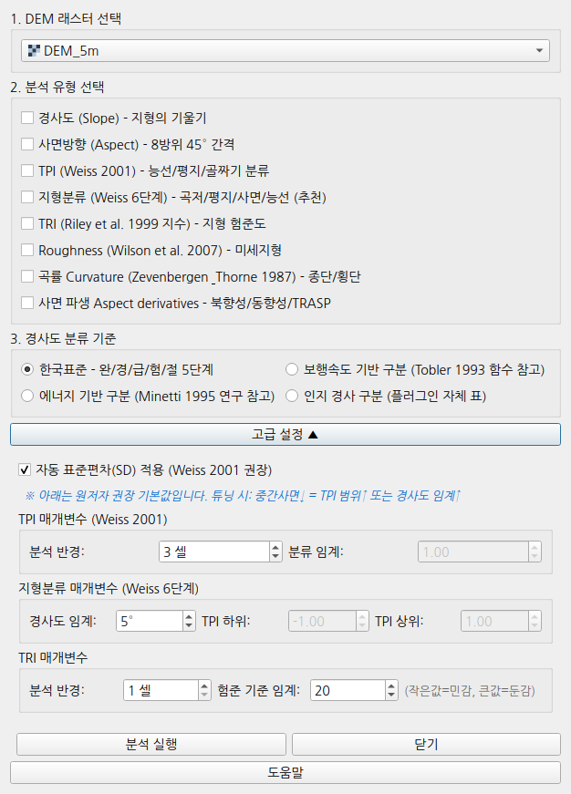
  &nbsp;
  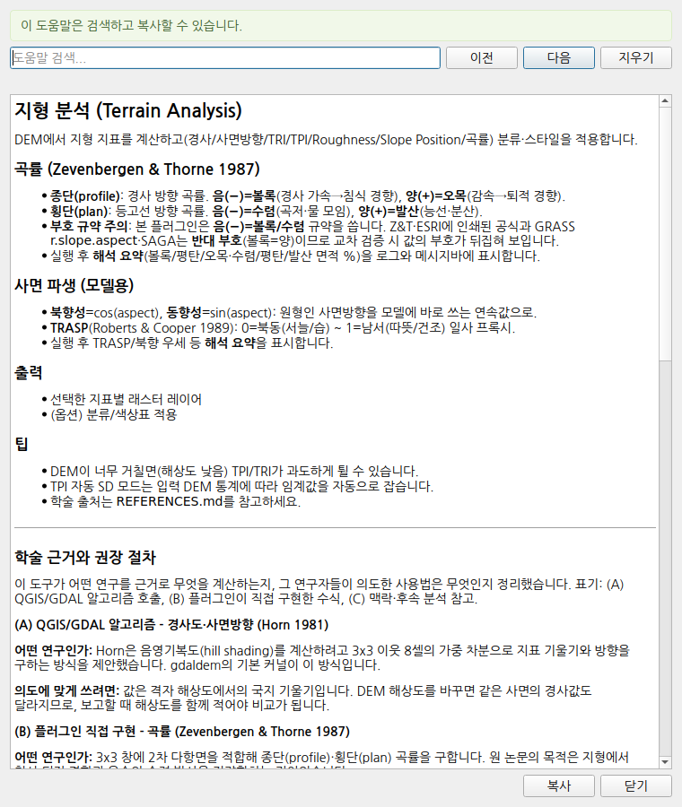
</p>

> "지식은 전유물이 아닙니다"

**ArchToolkit**은 한국 고고학·문화유산 조사와 학술 연구에서 반복되는 GIS 분석 19가지를 하나로 묶은 오픈소스 QGIS 플러그인입니다. 국토지리정보원 수치지형도 DXF, 국토교통부 연속지적도, 한국지질자원연구원(KIGAM) 1:50,000 수치지질도·전국 지구화학도 같은 국내 공공자료를 바로 다루며, QGIS 기본 구성(Processing·GDAL/OGR·PROJ·GEOS·NumPy)만으로 동작합니다. GRASS·SAGA·WhiteboxTools 같은 외부 의존성은 필요 없습니다.

---

## 핵심 원칙

실무에서 바로 쓰이면서도 학술 논문 심사 기준을 통과할 수 있는 정직한 데이터를 만들도록, 아래 원칙을 코드와 자동 테스트로 강제합니다.

| 원칙 | 내용 |
| --- | --- |
| **전 도구 1차 출처 검증** | 19개 도구 모두 도움말 끝에 **학술 근거와 권장 절차**가 붙습니다. 논문·DOI·표준·국내 법령 88건을 검증해 [REFERENCES.md](REFERENCES.md)에 수록했고, 자동 테스트(`tests/test_scholar_notes.py`)로 동기화를 강제합니다. |
| **출처 분리 (A / B / C)** | `(A)` QGIS·GDAL 호출, `(B)` 직접 구현 수식, `(C)` 맥락·표준·후속 참고를 명확히 분리하고, 표시 등급이나 트렌치 점수식처럼 플러그인이 정한 규칙은 "플러그인 정의"·"휴리스틱"으로 밝힙니다. |
| **좌표계·수치 왜곡 차단** | 지리좌표계(도)뿐 아니라 한반도에서 거리 약 25%·면적 약 60%를 과대 계산하는 웹 메르카토르(`EPSG:3857`)의 미터 오인을 차단하고, 정밀 NoData·북향 격자·원형 방위 통계·2D SAT 교차 판정을 적용합니다. |
| **재현성과 원자적 출력** | 모든 결과 레이어에 도구·실행 ID·단위·연구 활용 등급(`research_scope`)·해석 유의사항(`caveat`)·전체 파라미터(`params_json`)를 기록하며, 다중 파일 출력은 스테이징 후 원자적으로 게시(실패 시 롤백)합니다. |
| **조용히 넘어가지 않음** | 좌표변환 실패, 쓰기 오류, NoData, 위상 오류, 스캔 한도 절단, 색 매칭 실패, 도엽 간 지질코드 충돌, Kriging 이방성·추세 이탈, 검사 불가 가시선 쌍을 경고·필드·로그로 드러내며, 긴 연산은 작업 관리자에서 취소할 수 있습니다. |
| **독립 검증 체계** | 674건 단위·통합 테스트(QGIS 3.40·LTR Processing CI 통과), 27개 시나리오 회귀 하네스, GRASS·R·SciPy·NetworkX·Shapely 대비 실측 교차 벤치마크([docs/BENCHMARK.md](docs/BENCHMARK.md))를 공개합니다. |

---

## 외부 기준 소프트웨어 교차 벤치마크

"자체 구현 수식을 학술 연구에 믿고 써도 되는가?"에 수치로 답할 수 있도록, 동일한 합성 DEM·그래프·공변량 입력에서 독립된 외부 기준 소프트웨어와 실측 비교했습니다. 전체 8개 영역 표와 재현 스크립트는 [docs/BENCHMARK.md](docs/BENCHMARK.md) · [scripts/run_benchmarks.py](scripts/run_benchmarks.py)에 있습니다.

| 검증 영역 | 외부 기준 소프트웨어 | 핵심 실측 일치도 |
| --- | --- | --- |
| **지형 미분** (경사·방향·TPI·TRI·곡률) | GRASS 8.4 `r.slope.aspect`/`r.neighbors`, R 4.5 `terra`, 해석 미분 | 경사 RMSE `2.13e-5 deg` ($r = 0.999999999992$), TPI r=1/r=3 `< 1.7e-13 m`, 곡률 해석해 `1.0e-15` |
| **가시권** (곡률·굴절 `k=0.13`) | GRASS 8.4 `r.viewshed -b -c` | 6,360셀 중 **99.83% 일치**, IoU `99.28%`, Cohen's $\kappa = 0.9953$ |
| **이동비용 / LCP** (8방향 · 16방향 나이트) | GRASS 8.4 `r.walk` / `r.walk -k`, 유클리드 측지선 | 기복 8방향 최대오차 **`1.02e-12 s`** ($r = 1.0$), 16방향 평지 신장오차 **2.75%** (GRASS 동일), 기복 16방향 $r = 0.999990$ |
| **네트워크 중심성 · MST** | R 4.5 `igraph 2.3.3`, Python `NetworkX 3.6.1` | 가중 매개·근접·조화·군집·Kruskal MST 최대 오차 **`0.0`–`4.8e-13`** |
| **Kriging · LOOCV & 공변량 VIF** | R 4.5 `solve()` / `lm()` (정확 VIF·F-검정), SciPy 1.16 | Kriging 예측·분산 `< 8.7e-11`, 혼합 스케일 VIF 상대오차 `3.55e-11`, 순환 $R^2$ `< 8.5e-13` |
| **AHP 고유벡터·CR & 트렌치 2D SAT** | SciPy `linalg.eig`, Shapely 2.1 (GEOS) | AHP 5×5·12×12 오차 **`0.0`**, 회전 트렌치 500건·2,726셀 **100.0% 일치** |

---

## 연구 활용 등급 (Tier 1–3)

ArchToolkit은 모든 도구를 만능으로 포장하지 않고 **어디까지 학술 근거로 쓸 수 있는지** 3단계로 구분해 대화상자 상단 안내 배너와 레이어 메타데이터(`archtoolkit/research_scope`, `archtoolkit/caveat`)에 기록합니다. 논문 연구방법(Methods) 절 작성 예시와 심사위원 대응 체크리스트는 [docs/RESEARCH_GUIDE.md](docs/RESEARCH_GUIDE.md)에 있습니다.

| 등급 | 대상 도구 | 학술 연구 활용 원칙 |
| --- | --- | --- |
| **Tier 1 — 표준 알고리즘·전처리** (9) | 등고선 추출, 지형 분석, 경사·사면 도면화, 거리 래스터, 정렬/내보내기, 변수 상관/VIF, 지질도 ZIP, 지형 단면, 도면 시각화 | 외부 표준 소프트웨어와 일치하는 정량 연산. DEM 출처·해상도·좌표계·부호 규약을 밝혀 논문 직접 활용 가능. |
| **Tier 2 — 학술 모형** (6) | DEM 생성(Kriging 포함), 가시권 분석, 비용표면/LCP, 최소비용 네트워크, 근접·가시성 네트워크, AHP 입지적합도 | 원 논문 수식을 구현했으나 모형 가정(지형 단독 가시권, 격자 누적, 등방성 OK, 전문가 가중치)을 명시하고 상대 비교·교차 검증과 함께 해석. |
| **Tier 3 — 예비 탐색·현장·행정 보조** (4) | 지구화학도 수치화, 트렌치 후보 제안, 지적도 중첩 면적표, AI 조사요약 | WMS 색상 역추정, 휴리스틱 점수, 비법정 참고 면적, AI 초안이므로 현장·탐색 보조로만 사용하고 **논문 1차 정량 근거로 사용 금지**. |

---

## 도구 한눈에 보기 (19개)

각 도구의 상세 기능과 해석 주의는 [docs/TOOLS.md](docs/TOOLS.md), 전체 화면은 [docs/GALLERY.md](docs/GALLERY.md), 전체 88건 서지·DOI는 [REFERENCES.md](REFERENCES.md)에 있습니다.

### 1. 기초 지형·공공자료 (5)

| | 도구 | 핵심 기능 | 주요 학술·표준 근거 |
| :---: | --- | --- | --- |
| 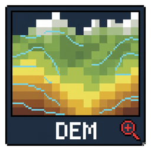 | **DEM 생성** | 등고선·표고점·3D 점으로 TIN(선형·곡면)·IDW·Ordinary Kriging(Lite, WLS·LOOCV·이방성/추세 진단) DEM 생성 | Delaunay 1934; Clough & Tocher 1965; Shepard 1968; Matheron 1963; Cressie 1985; Chilès & Delfiner 2012 |
| 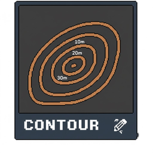 | **등고선 추출** | DEM에서 일정 간격 등고선 추출(`ELEV` 필드 호환) | GDAL/OGR 2026 (`gdal_contour`) |
| 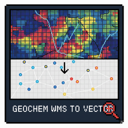 | **지질도 도엽 ZIP** | KIGAM 1:50,000 SHP/ZIP 로드(CP949/UTF-8 복원)·스타일·도엽 통합 범주형 래스터화 | KIGAM MGEO; ESRI 1998; PKWARE APPNOTE |
|  | **지구화학도 수치화** | KIGAM WMS 색상을 범례로 역추정(알파 경계·Stop 0 제외)·구역 통계·폴리곤화 | KIGAM MGEO; Porter & Duff 1984 *(추정값)* |
| 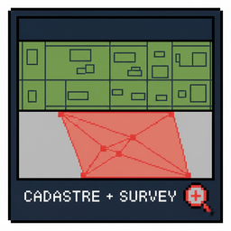 | **지적도 중첩 면적표** | 조사구역(AOI)과 연속지적도 필지의 중첩 면적·비율표(타원체/평면 기록) | Karney 2013; OGC SFA; 국토교통부 V-World |

### 2. 지형·가시권·이동·네트워크 분석 (6)

| | 도구 | 핵심 기능 | 주요 학술·표준 근거 |
| :---: | --- | --- | --- |
| 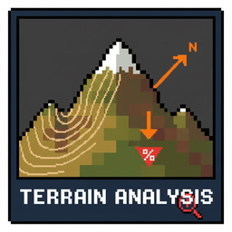 | **지형 분석** | 경사·사면방향·TPI(누적합표)·지형 위치 6분류·TRI·거칠기·곡률·사면 파생(TRASP) | Horn 1981; Weiss 2001; Crow 1984; Riley et al. 1999; Wilson et al. 2007; Zevenbergen & Thorne 1987; Roberts & Cooper 1989; 산림청 예규 |
| 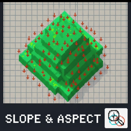 | **경사·사면 도면화** | AOI 기준 인쇄용 경사 래스터와 경사 가중 원형 평균 방위 화살표 | Horn 1981; Mardia & Jupp 2000; Imhof 1982 |
| 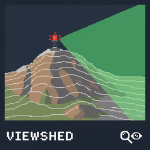 | **가시권 분석** | 단일·누적·가중 누적·역·선형 가시권, LOS 단면, 히구치 거리대, 곡률·굴절 보정 | Wang et al. 2000; Yoeli 1985; Fisher 1993; Higuchi 1975/1983; Wheatley 1995; Čučković 2016 |
| 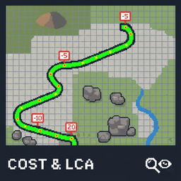 | **비용표면 / LCP** | 시간·에너지 비용표면(16방향 나이트 이동·절벽/장벽 보호), 최소비용경로, 회랑, 등시선 | Tobler 1993; Naismith 1892; Pandolf et al. 1977 (Santee et al. 2001); Minetti et al. 2002; Herzog 2013; Huber & Church 1985; Dijkstra 1959; Hart et al. 1968 |
| 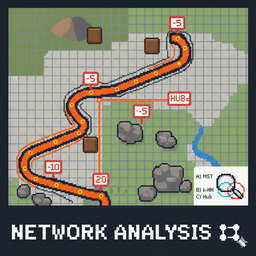 | **최소비용 네트워크** | 유적 간 최소비용경로 기반 MST·k-NN·허브 네트워크(16방향 지원)와 중심성·군집계수 | Kruskal 1956; Freeman 1979; Brandes 2001; Wasserman & Faust 1994; Watts & Strogatz 1998; Boldi & Vigna 2014 |
| 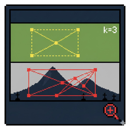 | **근접·가시성 네트워크** | PPA(k-NN·반경·Delaunay·Gabriel·RNG)와 곡률 보정 상호가시성 네트워크·SNA | Terrell 1977; Delaunay 1934; Gabriel & Sokal 1969; Toussaint 1980; Yoeli 1985; Van Dyke et al. 2016 |

### 3. 입지모델·공변량·다기준 평가 (4)

| | 도구 | 핵심 기능 | 주요 학술·표준 근거 |
| :---: | --- | --- | --- |
|  | **거리 래스터** | 하천·유적·도로 등 대상 피처까지의 유클리드 거리 예측변수(NoData 전파) | GDAL/OGR 2026 (`gdal_proximity`); Battersby et al. 2014; Phillips et al. 2006 |
| 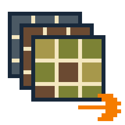 | **정렬 / 내보내기** | 예측변수 스택을 북향 단일 격자로 정렬(범주·방향 최근접)하고 `manifest.csv` 생성 | GDAL/OGR 2026 (`gdalwarp`); Snyder 1987; Phillips et al. 2006; Elith et al. 2011 |
| 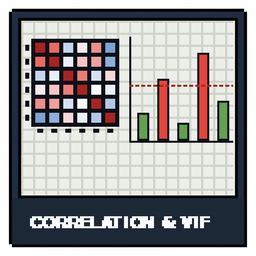 | **변수 상관 / VIF** | AOI 내부 표본의 Pearson·Spearman 상관, z-표준화 VIF, 원형-선형 $R^2$·정확 F-검정 | Pearson 1895; Spearman 1904; Marquardt 1970; Mardia 1976; O'Brien 2007 |
| 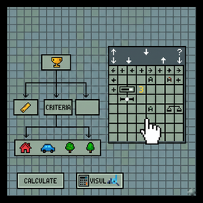 | **AHP 입지적합도** | 쌍대비교 주고유벡터 가중치, 계층형 AHP(그룹·하위 CR 분리), OAT 민감도 보고서 | Saaty 1980; Alonso & Lamata 2006; Malczewski 2004; Chen et al. 2010 |

### 4. 조사 설계·도면화·보고 (4)

| | 도구 | 핵심 기능 | 주요 학술·표준 근거 |
| :---: | --- | --- | --- |
| 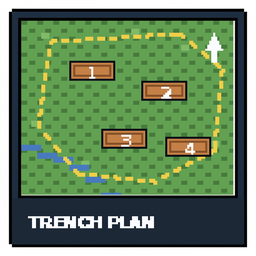 | **트렌치 후보 제안** | 2D SAT 발자국 경사 검사·축방향(`2θ`) 방위·무덤 회피 기반 AOI 분산 배치 제안 | Gottschalk et al. 1996; Mardia & Jupp 2000; Kintigh 1988; Orton 2000; Banning 2002; 매장유산법 *(휴리스틱)* |
| 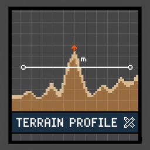 | **지형 단면** | 다중 단면선 작성·지도 연동·AOI 음영·수직 과장 표기·NoData 분리 통계·CSV/이미지 | Karney 2013; Imhof 1982/2007 |
| 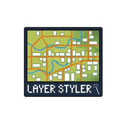 | **도면 시각화** | 수치지형도 DXF 표준코드 스타일·DEM 음영기복/그레이/고도색상·프리셋 내보내기 | Horn 1981; 국토지리정보원 Ver 5.1.1; Imhof 1982; Harrower & Brewer 2003 |
|  | **AI 조사요약** | AOI·버퍼 주변 벡터/래스터(원형 통계 포함) 로컬 번들 생성 및 동의 기반 Gemini 초안 | Karney 2013; Mardia & Jupp 2000; OWASP CSV; Wilkinson et al. 2016 (FAIR); Carroll et al. 2020 (CARE); 매장유산법 |

> 공통 측지·투영·소프트웨어 기반(`Karney 2013`, `Snyder 1987`, `Battersby et al. 2014`, `GDAL/OGR 2026`, `OGC SFA`)과 전체 88건 서지·DOI는 [REFERENCES.md](REFERENCES.md)에 있습니다.

<p align="center">
  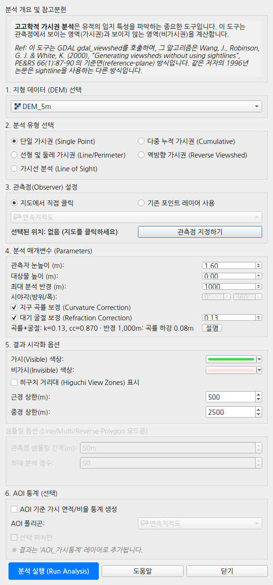
  &nbsp;
  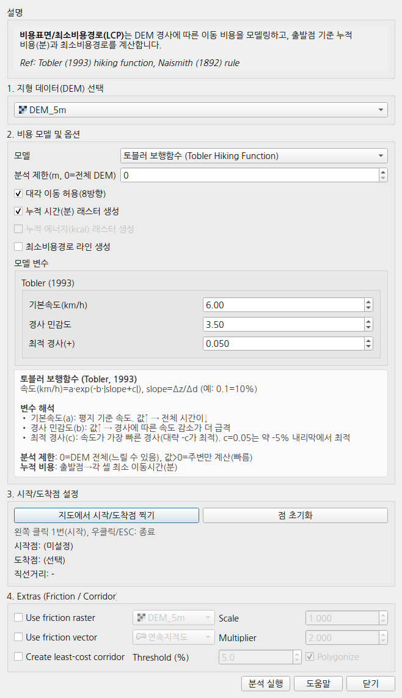
  &nbsp;
  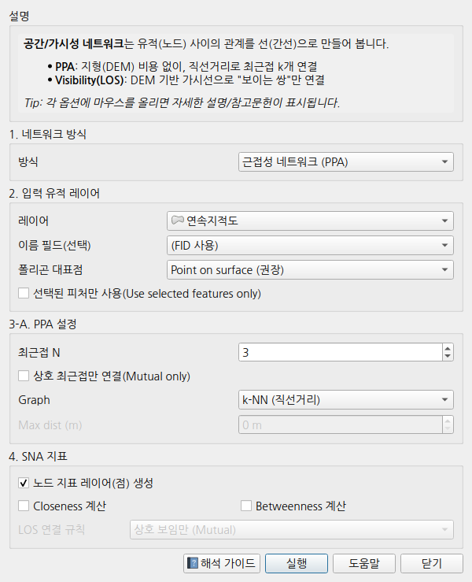
</p>

---

## 대표 워크플로

설치 후 `Archaeology Toolkit` 메뉴 또는 툴바의 `ArchToolkit` 버튼에서 도구를 열어 목적에 맞게 이어 씁니다.

- **지표·시굴조사 준비**: `도면 시각화` + `DEM 생성` -> `경사·사면 도면화` + `지적도 중첩` + `지형 단면` -> `AHP 입지적합도` -> `트렌치 후보 제안` -> `AI 조사요약`
- **입지예측모델(MaxEnt 등) 공변량 구축**: `DEM 생성` -> `지형 분석`(북향성·동향성·TRASP) + `거리 래스터` + `지질도 도엽 ZIP` -> `정렬/내보내기`(`manifest.csv`) -> `변수 상관/VIF`
- **고대 경관·이동·네트워크 분석**: `DEM 생성` -> `가시권 분석`(누적·히구치·LOS) / `비용표면·LCP`(16방향 나이트 이동) -> `최소비용 네트워크` · `근접·가시성 네트워크`

---

## 설치

**요구 사항**: QGIS 3.40 LTR 이상, Processing, GDAL/OGR, NumPy가 포함된 QGIS Python. `AI 조사요약`의 Gemini 모드에서만 API 키가 필요하며, 로컬 모드를 포함한 모든 기능은 오프라인으로 동작합니다.

1. **QGIS 공식 플러그인 저장소 (권장)**
   QGIS **플러그인 -> 플러그인 관리 및 설치 -> 모두**에서 `ArchToolkit`을 검색해 설치하거나 최신 버전으로 업그레이드합니다.
2. **GitHub Releases ZIP 설치**
   [Releases](https://github.com/lzpxilfe/archtoolkit/releases)에서 `ArchToolkit-0.1.7.zip`을 받아 **플러그인 관리 및 설치 -> ZIP에서 설치**로 올립니다.
3. **저장소 폴더 직접 설치 (`git clone`)**
   저장소를 `ArchToolkit` 폴더명으로 아래 경로에 복제한 뒤 QGIS를 재시작합니다.

```text
Windows: %APPDATA%\QGIS\QGIS3\profiles\default\python\plugins\ArchToolkit
macOS:   ~/Library/Application Support/QGIS/QGIS3/profiles/default/python/plugins/ArchToolkit
Linux:   ~/.local/share/QGIS/QGIS3/profiles/default/python/plugins/ArchToolkit
```

**QGIS 4(Qt6/PyQt6)**: `qgisMaximumVersion=4.99`로 설정되어 있으며, QGIS 3.40·LTR 실실행과 PyQt6 6.11 이름 호환성을 CI에서 자동 검증합니다. 다만 QGIS 4 실제 빌드 실행은 아직 검증하지 못했으므로 문제가 보이면 [이슈](https://github.com/lzpxilfe/archtoolkit/issues)로 알려 주세요([docs/PUBLISHING.md](docs/PUBLISHING.md) 6절).

---

## 결과 레이어와 재현성 메타데이터

결과는 `ArchToolkit - ...` 그룹 아래에 누적 정리되며, 모든 주요 결과 레이어에는 재현성과 해석 투명성을 위한 custom property가 자동 기록됩니다.

| 키 | 설명 |
| --- | --- |
| `archtoolkit/tool_id` | 생성 도구 식별자 |
| `archtoolkit/run_id` | 같은 실행의 레이어를 묶는 실행 ID |
| `archtoolkit/kind`, `archtoolkit/units` | 변수 유형(연속·범주·방향)과 단위(`deg`, `m`, `s`, `kcal`, `index` 등) |
| `archtoolkit/research_scope`, `archtoolkit/caveat` | 연구 활용 등급(`tier1_standard` / `tier2_conditional` / `tier3_exploratory_aid`)과 해석 유의사항 |
| `archtoolkit/params_json` | 반경·임계값·모델·좌표계·격자 연결성·이방성/추세 진단 등 전체 실행 파라미터 |

`정렬/내보내기`, `변수 상관/VIF`, `AHP 입지적합도`, `AI 조사요약`은 이 메타데이터를 읽어 범주형·원형(사면방향) 변수를 올바르게 처리합니다.

---

## 0.1.7 주요 업데이트

- **좌표계·파일 무결성**: 웹 메르카토르(`EPSG:3857`) 미터 오인 전면 차단, 네이티브 자료형 정밀 NoData 비교, 북향 격자 검증, GDAL 쓰기 오류 검증 및 다중 파일 원자적 롤백.
- **물리·통계·네트워크 정교화**: **16방향 나이트 이동(최대 신장오차 8.24% -> 2.75%)**, Herzog 실제 대사 `kcal`, 보행 70° 절벽 차단·장벽 관통 방지, Kriging 고기복 스케일링·Cressie WLS·Gaussian 너겟 안정화·**4방위 이방성/평면 추세 자동 진단**, 스케일 불변 매개중심성·RNG, VIF z-표준화·원형-선형 정확 F-검정, 계층형 AHP 그룹·하위 CR 분리 보고.
- **도구별 정직성과 연구 유의 안내**: Tier 2·Tier 3 대화상자 상단 안내 배너 및 `research_scope`/`caveat` 자동 메타데이터, 트렌치 2D SAT 발자국 경사·대칭 능선 `2θ` 방위, 가시권 비정사각 DEM 역변환·다중 누적 카운트 보존, 사면방향 원형 통계, 지구화학도 프리멀티플라이 알파 제외, 지질도 ZIP CP949/UTF-8 복원.
- **학술 검증 완비**: 19개 전 도구 검증 레퍼런스 88건([REFERENCES.md](REFERENCES.md)), 외부 기준 소프트웨어 교차 벤치마크([docs/BENCHMARK.md](docs/BENCHMARK.md)), 학술 논문 기술 가이드([docs/RESEARCH_GUIDE.md](docs/RESEARCH_GUIDE.md)), Zenodo 영구 DOI 메타데이터(`.zenodo.json`). 전체 이력은 [CHANGELOG.md](CHANGELOG.md)에 있습니다.

---

## 검증 및 재현

```bash
# 1. 순수 코어 테스트 + 정적 검사 + 릴리스 정합성 + 업로드 ZIP 검증
python -m unittest discover -s tests -p "test_*.py"
python tests/check_static.py
python scripts/check_release_identity.py
python scripts/build_plugin_zip.py --check

# 2. 외부 기준 소프트웨어 교차 벤치마크 (GRASS 8.4 / R 4.5 / GDAL / SciPy / NetworkX / Shapely)
python scripts/run_benchmarks.py --json scripts/benchmark_results.json

# 3. Linux QGIS Python (Processing 포함 전체 통합 테스트)
QT_QPA_PLATFORM=offscreen PYTHONPATH=/usr/share/qgis/python/plugins \
  /usr/bin/python3 -m unittest discover -s tests -p "test_*.py"

# 4. PyQt6 (QGIS 4) 이름 호환성 검사
python -m pip install PyQt6 && python -m unittest tests.test_qt6_compat
```

```powershell
# Windows QGIS 3.40 LTR (PowerShell, Processing 포함 전체 통합 테스트)
$env:QT_QPA_PLATFORM = "windows"
$qgis = "C:\Program Files\QGIS 3.40.5"
& "$qgis\bin\python-qgis-ltr.bat" -c `
  "import sys, unittest; sys.path.insert(0, r'$qgis\apps\qgis-ltr\python\plugins'); r = unittest.TextTestRunner(verbosity=1).run(unittest.defaultTestLoader.discover('tests', pattern='test_*.py')); raise SystemExit(0 if r.wasSuccessful() else 1)"
```

---

## 문서

| 문서 | 내용 |
| --- | --- |
| [docs/BENCHMARK.md](docs/BENCHMARK.md) | 외부 기준 소프트웨어(GRASS 8.4 · R 4.5 · GDAL · SciPy · NetworkX · Shapely) 실측 교차 벤치마크 |
| [docs/RESEARCH_GUIDE.md](docs/RESEARCH_GUIDE.md) | 학술 연구 활용 등급(Tier 1–3), 논문 Methods 절 예시, 심사위원 대응 가이드 |
| [REFERENCES.md](REFERENCES.md) | 19개 도구·공통 공간 기반 학술·표준·법령 출처 88건 (A/B/C 표기, DOI 검증) |
| [docs/TOOLS.md](docs/TOOLS.md) | 19개 도구별 상세 기능과 해석 주의 |
| [docs/GALLERY.md](docs/GALLERY.md) | 모든 도구 실행 화면 |
| [docs/AHP_GUIDE.md](docs/AHP_GUIDE.md) | AHP 입지적합도 사용 설명서 |
| [CHANGELOG.md](CHANGELOG.md) | 버전별 상세 변경 이력 |
| [docs/REGRESSION_REPORT.md](docs/REGRESSION_REPORT.md) | 수정 전후 27개 시나리오 회귀 비교 결과 |
| [docs/AUDIT_BACKLOG.md](docs/AUDIT_BACKLOG.md) | 감사 결과와 반영 상태 |
| [docs/PUBLISHING.md](docs/PUBLISHING.md) | QGIS 플러그인 저장소 업로드, ZIP 빌드, QGIS 4 호환, Zenodo DOI 발급 절차 |
| [DEVELOPMENT.md](DEVELOPMENT.md) | 개발 원칙, 테스트, 품질 게이트 |
| [CONTRIBUTING.md](CONTRIBUTING.md) | 기여 가이드 |

---

## 인용

학술 논문이나 조사보고서에서 사용했다면 [CITATION.cff](CITATION.cff) 및 [Zenodo 메타데이터](.zenodo.json)로 소프트웨어를 인용하고, 개별 분석 방법의 1차 문헌은 [REFERENCES.md](REFERENCES.md)에서 함께 인용해 주세요.

- 저자: Jinseo Hwang ([ORCID: 0009-0000-8228-4083](https://orcid.org/0009-0000-8228-4083))

```bibtex
@software{ArchToolkit_Hwang_2026,
  author  = {Hwang, Jinseo},
  title   = {ArchToolkit: Archaeology Toolkit for QGIS},
  year    = {2026},
  version = {0.1.7},
  url     = {https://github.com/lzpxilfe/archtoolkit}
}
```

<a href="https://github.com/lzpxilfe/archtoolkit"></a>

## 라이선스

[GPL-3.0-or-later](LICENSE)
