# 도구별 기능 상세

각 도구의 도움말 끝에는 **학술 근거와 권장 절차**가 있습니다(구현한 연구·표준, 저자·규정의 의도, 권장 순서, 주장하지 않는 것, 원문). 여기서는 19개 도구의 기능 범위와 해석 시 유의점을 정리합니다. 화면은 [GALLERY.md](GALLERY.md), 전체 서지·DOI·(A/B/C) 구분은 [REFERENCES.md](../REFERENCES.md)를 보십시오.

## 기초 데이터

### 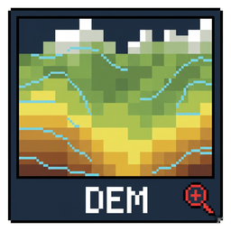 DEM 생성 (Generate DEM)
- 등고선·표고점·3D 포인트에서 `TIN - Linear`(Delaunay 1934), `TIN - Clough-Tocher`(Clough & Tocher 1965), `IDW`(Shepard 1968), `Kriging (Lite, Ordinary)`(Matheron 1963; Cressie 1985)로 DEM을 만듭니다.
- 표고 필드(ELEV·표고·고도·Elevation 등)를 자동 인식하고, 필드도 3D 좌표도 없는 2D 레이어는 실행을 거부합니다(빈 DEM을 "완료"로 보고하지 않음).
- 출력 격자는 픽셀 크기의 정수배로 스냅되며, 실제 x/y 픽셀 크기가 메타데이터에 기록됩니다.
- Kriging은 측점에서 입력값을 정확히 재현하며(너겟>0 동일 좌표 중복점 분산 구분 포함, Chilès & Delfiner 2012), 대각 유사 스케일링(Golub & Van Loan 2013)으로 고기복 행렬 조건수를 안정화합니다. 수동 지정 또는 Cressie(1985) WLS 직접 최소화 자동 베리오그램 적합과 LOOCV(RMSE, MAE, MSDR)를 지원합니다. 다만 경량화된 국소 Ordinary Kriging(Lite)이므로 `_variance.tif`는 모델 가정에 의존하는 상대적 불확실성 지도로 해석하십시오.
- 수치지형도 DXF 코드 프리셋은 이 대화상자에서 DXF로 불러온 레이어에만 적용됩니다.
- 등고선과 표고점을 다른 레이어로 함께 넣을 수 있습니다(점은 점, 선·면은 구조선). 지리 좌표계(도), 웹 메르카토르(`EPSG:3857`), Z가 모두 0인 3D 자료는 거부합니다.

### 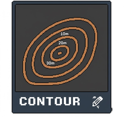 등고선 추출 (Extract Contours)
- DEM에서 `gdal_contour`(GDAL/OGR contributors 2026)로 일정 간격 등고선을 만듭니다. 결과 필드 `ELEV`는 DEM 생성 도구가 그대로 읽습니다.

### 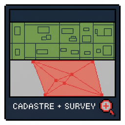 지적도 중첩 면적표 (Cadastral Overlap)
- 국토교통부 연속지적도(V-World)와 조사구역(AOI)의 교차 면적을 `parcel_m2`, `in_aoi_m2`, `in_aoi_pct`로 기록합니다. 프로젝트 타원체가 있으면 `QgsDistanceArea`(Karney 2013) 타원체 면적, 없음(NONE)이면 투영 평면 면적을 사용하며 GEOS(OGC SFA / ISO 19125-1)로 유효화·교차합니다.
- 면적 방식(타원체 또는 투영 평면)이 메타데이터 `area_method`에 남고, 지리 좌표계 및 웹 메르카토르(`EPSG:3857`) 평면 면적 왜곡을 경고합니다. 분할 모드의 합계는 겹치는 조사지역을 한 번만 세며 100% 클램프·위상 오류 건수 경고를 함께 보고합니다.

## 분석

### 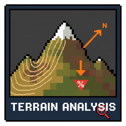 지형 분석 (Terrain Analysis)
- 경사·사면방향(Horn 1981, gdaldem), TPI와 지형 위치 6분류(Weiss 2001; Crow 1984 누적합표), TRI(Riley et al. 1999), Roughness(Wilson et al. 2007; Hengl & Reuter 2009), 곡률(Zevenbergen & Thorne 1987; Moore et al. 1991), 사면 파생(북향성·동향성·TRASP; Roberts & Cooper 1989).
- 반경 2셀 이상 TPI는 Crow(1984) 2차원 누적합표로 `(2r+1)×(2r+1)` 창의 정확한 초점평균(중심 셀 제외, 유효 셀 비율 75% 미만 시 NoData)을 계산하며, 레이어 이름과 메타데이터에 실제 창과 반경이 기록됩니다. 작은 DEM에서는 3×3으로 대체하고 그 사실을 알립니다. 가장자리 `r`셀은 NoData이며, 사면방향의 평탄 셀은 `-1`, NoData는 `-9999`, 정북은 N 구간입니다.
- 곡률 부호: 종단 음(-)=볼록, 횡단 음(-)=수렴. GRASS·SAGA와 부호가 반대입니다.
- 경사 등급 프리셋 가운데 "한국표준"만 공식 규정(산림청 예규) 분류이고, 나머지 3종은 플러그인이 정한 표시 구분입니다.
- 지리좌표계(도)뿐만 아니라 웹 메르카토르(`EPSG:3857`)처럼 거리가 위도별로 왜곡되는 투영좌표계도 거부합니다(Battersby et al. 2014).

### 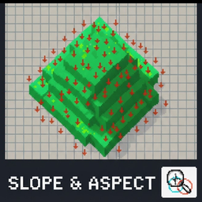 경사도/사면방향 도면화 (Slope/Aspect Drafting)
- AOI 기준 인쇄용 경사 래스터(Horn 1981)와 방위각 화살표 포인트를 만듭니다. 지리 좌표계와 웹 메르카토르(`EPSG:3857`) DEM은 거부합니다.
- 화살표 격자 블록은 단일 중심 셀이 아니라 블록 전체 유효 셀의 평균 경사와 경사 가중 원형 평균 방위(Mardia & Jupp 2000; Imhof 1982)를 사용합니다. 경사 단계가 구역 병합과 라벨을 정합니다(예: 5° 단계면 5-10° 구역).

### 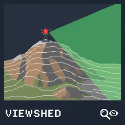 가시권 분석 (Viewshed Analysis)
- 단일·누적·가중 누적·역가시권·선형 가시권, LOS 단면, AOI 가시 통계. `gdal_viewshed`(Wang et al. 2000; Fisher 1993) 기반, 지구 곡률·대기 굴절 보정(Yoeli 1985, 기본 굴절계수 0.13)을 가시권과 LOS에 일원화 적용합니다(누적 가시권·출력 구조 참고: Wheatley 1995; Čučković 2016).
- 히구치 거리대(Higuchi 1975/1983)의 경계(기본 500 m / 2500 m)는 실무 관례이며 히구치의 정의(D/H 비율)에 맞게 대상 높이에 따라 조정할 수 있습니다. 사용한 값은 메타데이터에 기록됩니다.
- 반경 밖과 DEM NoData 셀은 NoData입니다(보이지 않음 0과 구분). 비정사각 DEM에서도 역 GeoTransform으로 정확히 매핑하며, 20개 초과 다중 관측점 누적 모드에서도 이진 합집합으로 축소되지 않고 누적 카운트를 유지합니다. DEM 밖이나 NoData 위의 관측점은 단일 모드에서 거부하고 다른 모드에서는 제외한 뒤 개수를 보고합니다. LOS는 DEM 픽셀 간격으로 표본을 뽑고, 경로 중 NoData는 '판정 불가'로 분리합니다.

### 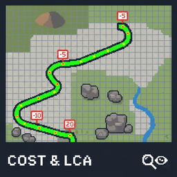 비용표면/최소비용경로 (Cost Surface / LCP)
- Tobler(1993; Imhof 1950)·Naismith(1892)·Pandolf(Pandolf et al. 1977; Santee et al. 2001)·Herzog(Minetti et al. 2002; Herzog 2013; Čučković 2025) 모델과 플러그인 정의 상대 경사 비용(Conolly & Lake 2006 논의 참고), 추가 마찰, Dijkstra(1959)·A*(Hart et al. 1968) LCP·회랑·등시선.
- Herzog 메타볼릭 에너지 모드는 실제 대사 에너지(`body_kg * C(s) * horiz_m`, `kcal` 표시)를 산출하고, Pandolf 내리막은 하중 포함 기립 대사율(`1.5·W + 2.0·(W+L)·(L/W)²`)로 하한 처리합니다. 보행 모델은 70° 초과 절벽을 통행 불가(`+inf`)로 차단하며, A*/Dijkstra는 1픽셀 대각선 NoData·고마찰 장벽 관통(터널링)을 차단합니다.
- 8방향 격자 누적이라 누적 비용이 측지선 대비 최대 약 8% 과대평가될 수 있습니다(4방향은 약 41%; Goodchild 1977; Douglas 1994). 절대값보다 상대 비교로 해석하십시오(White & Surface-Evans 2012).
- Pandolf 시간 모드는 경사에 반응하지 않습니다. 상대 경사 비용은 기준 경사(기본 5°)에 따라 결과가 달라지므로 기준 경사를 함께 보고하십시오. 차량/수레(Herzog 2013) 임계경사는 경사도 %입니다(기본 12%: 이 경사에서 비용이 평지의 2배). 마일스톤·프로파일 시간에도 마찰이 반영되고, 모든 모델 변수가 메타데이터에 남습니다.

### 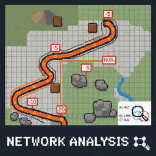 최소비용 네트워크 (Least-cost Network)
- LCP 비용으로 MST(Kruskal 1956)·k-NN·허브 네트워크와 중심성(연결·근접·매개·조화 중심성 및 국소 군집계수; Freeman 1979; Brandes 2001; Wasserman & Faust 1994; Watts & Strogatz 1998; Boldi & Vigna 2014)을 계산합니다. 가중 매개중심성에는 스케일 불변 상대 동점 허용오차를 적용합니다. 후보 간선은 유클리드 k-최근린으로 먼저 추리므로 MST는 후보 집합 위의 근사입니다.
- 같은 DEM 셀의 유적 쌍은 직선 간선으로 연결됩니다. 대칭화 방식은 모든 모드에서 보이고 기록되며, All 모드의 SNA는 MST·k-NN·허브 간선의 합집합 기준입니다.

### 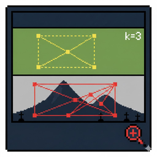 근접/가시성 네트워크 (PPA / Visibility)
- PPA(Terrell 1977; Brughmans & Peeples 2017): k-NN·반경·Delaunay(1934)·Gabriel(Gabriel & Sokal 1969, 엄격 정의)·RNG(Toussaint 1980, 스케일 불변 `rel_tol`). 좌표가 같은 유적은 서로 연결되고 이웃 간선을 공유하며, 유적이 2곳이거나 일직선이면 경로가 됩니다.
- 가시성(Yoeli 1985; Van Dyke et al. 2016; Gillings & Wheatley 2001): 양선형 보간 DEM 표본과 곡률·굴절 보정(기본 0.13)을 적용합니다. DEM NoData로 검사하지 못한 쌍은 "샘플 실패"로 세고 노드의 `fail_deg`에 기록하며, 폴리곤 입력의 `vis_ratio`는 유효 표본 분모로 계산합니다. `betweenness`는 원시 쌍 개수, `betw_norm`은 정규화값, `harmonic`은 단절 그래프 대응 조화 중심성입니다.

###  거리 래스터 (Distance to Features)
- 대상 피처를 굽고(선·면은 `-at`로 닿는 셀 모두) `gdal_proximity`(GDAL/OGR contributors 2026)로 셀별 최근접 유클리드 거리를 계산합니다. 대상 셀이 없거나 기준 픽셀이 정사각이 아니거나 기준 CRS가 미터 투영이 아닌 경우(지리좌표계·`EPSG:3857` 포함; Battersby et al. 2014) 거부합니다. 최대 거리 밖 셀과 기준 래스터의 NoData 마스크가 출력에 그대로 전파됩니다(남향 기준 래스터 정렬 포함). 후속 예측모델(Phillips et al. 2006)용 연속 변수입니다.

### 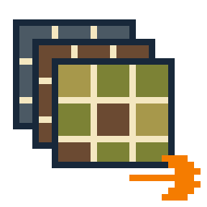 분석 결과 정렬/내보내기 (Align & Export Stack)
- 결과 래스터를 하나의 북향(North-Up) 기준 격자(CRS·범위·픽셀)로 `gdalwarp`(GDAL/OGR contributors 2026; Snyder 1987) 정렬하고 원자적으로 게시해 실행별 스택과 `manifest`로 내보냅니다(후속 MaxEnt 등: Phillips et al. 2006; Elith et al. 2011). 범주형과 방향(사면방향) 변수는 최근접, 연속형은 이중선형. NoData는 래스터별로 manifest `nodata` 열에 기록됩니다.
- 메타데이터가 없는 래스터는 `categorical=unknown`으로 표시되며, 정수형에 값 종류가 적으면 최근접으로 처리합니다. 유효 픽셀 비율(`valid_pct`)이 함께 기록됩니다.
- AOI로 자를 때 AOI 경계 상자를 기준 격자에 바깥쪽으로 맞추므로 출력 셀은 항상 기준 셀과 일치합니다. 레이어 속성에서 지정한 NoData(파일에 없는 값)도 리샘플링에서 제외됩니다. CRS가 파일에도 레이어에도 없는 소스는 거부합니다.

### 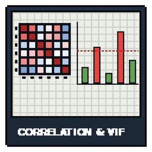 변수 상관/VIF 리포트 (Correlation & VIF)
- Pearson(1895) 적률상관, Spearman(1904) 순위상관, z-표준화 VIF(Marquardt 1970)를 계산하고, 사면방향 같은 원형 변수는 연속 행렬에서 제외해 Mardia(1976) 순환-선형 R²와 정확 F-검정 p-값(n>=4)으로 별도 평가합니다. 상수·이동 상수 열의 거짓 상관(`r=-1.0`)을 차단합니다.
- VIF 임계값 5·10은 규칙이 아니라 참고선이며 리포트도 그렇게 표기합니다(O'Brien 2007; Elith et al. 2011). AOI는 폴리곤 내부 표본으로 적용되고, 표본 수는 셀 수를 넘지 않으며(초과 요청 시 전수), 취소하면 리포트를 만들지 않습니다.

### 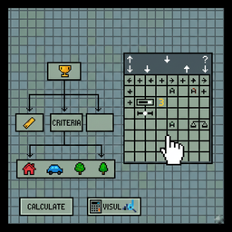 AHP 입지적합도 (AHP Suitability)
- 쌍대비교 주고유벡터 가중치(Saaty 1980), 무작위 지수 RI 확장(n=11-15, Alonso & Lamata 2006), GIS 가중 선형 결합(Malczewski 2004), 일대일(OAT) 민감도 분석(Chen et al. 2010) 및 Markdown 방법론 보고서를 제공합니다.
- 계층 모드에서는 전역가중치가 실제 계산에 쓰이며 메타데이터의 `weights_source`에 기록되고, 방법론 보고서에는 평면 시드 CR 대신 그룹 CR과 각 하위 로컬 CR, 실제 `±delta%` 민감도 범위가 정확히 표시됩니다. 연속 구간표의 소수 갭을 거부하고 사면방향(원형) 래스터에는 최근접 리샘플링을 강제합니다. 자세한 사용법은 [AHP_GUIDE.md](AHP_GUIDE.md).

### 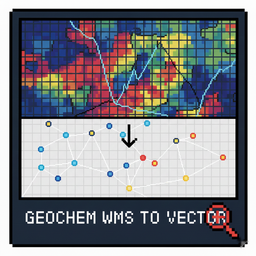 지질도 도엽 ZIP (KIGAM)
- 한국지질자원연구원(KIGAM MGEO) 1:50,000 수치지질도 ZIP 해제, SHP 로드, 스타일·라벨 적용, 지질 코드의 정수 래스터 변환. UTF-8 플래그(`0x800`, PKWARE APPNOTE) 미표시 CP949 한글 도엽명을 복원하고 `.cpg`/`.dbf` 인코딩(ESRI 1998)을 존중하며 ZIP 경로 탈출과 OOM 셀 한도를 검사합니다.
- 코드표는 실행 전체에서 하나로 통일되고 `*_mapping.csv`에 셀 수(`cell_count`)와 함께 저장됩니다. 숫자·문자열(`LITHO`) 코드 모두 도엽 간 라벨 충돌과 셀보다 좁은 암체를 경고로 표시하며, NULL·공백 코드는 클래스로 굽지 않고 '값 없음'으로 셉니다.

###  지구화학도 래스터 수치화 (GeoChem)
- KIGAM 전국 지구화학도 WMS 렌더링 색상을 범례(색-값)로 역추정합니다. 반투명 경계 픽셀(`alpha < 250`)은 프리멀티플라이 알파 합성(Porter & Duff 1984)에 의한 고농도 오매칭을 막기 위해 NoData로 제외하고, 회색 무자료 구간(Stop 0)은 연속 보간에서 분리하며, 범례 색과 먼 픽셀은 NoData로 제외해 비율을 경고합니다.
- 구역 통계는 픽셀 중심 규칙이며 `zone_area`와 비교할 수 있습니다. 경계선 보간은 무채색 선과 안티앨리어싱 가장자리만 최근접 값 복사로 채웁니다(흰 배경 등은 NoData). GeoPackage 저장 후에도 분류 스타일과 한글 별칭을 보존합니다. 값은 추정값입니다.

### 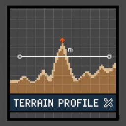 지형 단면 (Terrain Profile)
- 단면선 작성·저장·재선택, 다중 프로파일, 지도-차트 연동, AOI 음영, CSV·이미지 내보내기. 수평 거리는 `QgsDistanceArea`(Karney 2013)로 계산합니다.
- 지도학 원칙(Imhof 1982/2007)에 따라 그래프는 원시 샘플을 기본으로 그리며(평활화는 선택), 수직 과장 배율을 화면과 내보낸 이미지에 명시합니다. 해안 0 m 고도를 정상 보존하고 NoData 구간에서는 선을 끊어 상승·경사 통계에서 제외하며 시작/끝 NoData 길이를 CSV에 기록합니다.

## 조사 설계·도면화·보고

### 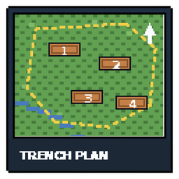 트렌치 후보 제안 (Trench Suggestion)
- AOI 안에서 폭·길이·개수·간격·내부 포함비율 조건으로 후보를 만들고 AOI 전체에 분산 배치합니다. `rank`는 점수순, `pick_order`는 배치 순서입니다.
- `slope_max_deg`는 2D 분리축 정리(SAT; Gottschalk et al. 1996)로 회전된 트렌치 사각형과 겹치는 모든 DEM 셀 박스를 정확히 교차 판정해 계산하며, 대칭 능선에서는 배각(`2θ`) 축방향 통계(Mardia & Jupp 2000)로 배치 방위를 결정합니다.
- AHP 값이 NoData인 후보와 DEM이 없는 후보는 제외되며, 무덤 회피 union 실패 시 fail-closed로 중단합니다. 무덤 회피는 수치지형도 속성과 범례 어휘에 의존하므로 "대상 0건"이 무덤이 없다는 뜻은 아닙니다. 고고학 시굴·표본조사 맥락(Kintigh 1988; Orton 2000; Banning 2002; 매장유산법)을 참고하되 배치 점수식 자체는 플러그인 휴리스틱입니다.

### 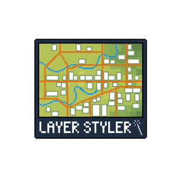 도면 시각화 (Map Styling)
- 수치지형도 DXF 레이어를 도로·하천·건물 중심으로 분류 스타일링, DEM 배경(음영기복 Horn 1981 `index` 단위·그레이·고도색상 Imhof 1982 / Harrower & Brewer 2003), QML·JSON 프리셋 내보내기.
- 코드 이름은 국토지리정보원 코드표(전국 연속수치지형도 코드 및 레이어 설명서 Ver 5.1.1, 지형지물 표준코드)를 따릅니다. 혼합 지오메트리를 필터링하고 스타일하지 않은 피처는 코드별로 개수를 보고합니다.

###  AI 조사요약 (AOI Report)
- AOI 반경 내 레이어를 스캔해 로컬 요약 번들(FAIR 원칙 참고, Wilkinson et al. 2016) 또는 선택적 Gemini API 초안을 만듭니다. 면적·거리는 `QgsDistanceArea`(Karney 2013), 사면방향 등 원형 래스터는 원형 평균 방위·집중도 R(Mardia & Jupp 2000)로 집계하고, CSV 내보내기 시 OWASP 권고에 따라 수식 주입을 방어합니다.
- 레이어별 개수·길이·면적·래스터 통계는 AOI에 반경을 더한 버퍼 기준이며 리포트·CSV·프롬프트에 그렇게 표기됩니다. 범주형 래스터는 클래스 히스토그램으로, 무효 기하는 개수로 따로 보고됩니다. 레이어 이름·CRS·필터·편집 변경 시 캐시를 무효화하며, 스캔 한도·표본 비율·절단 여부와 잘린 응답을 명시합니다.
- 무료(로컬) 모드는 외부로 아무것도 전송하지 않습니다. Gemini 모드는 범위 변경 시마다 사전 동의를 다시 확인한 뒤 AOI 정보·레이어 통계·유적 거리·방위를 Google 서버로 보내므로, 문화유산 데이터 거버넌스(Carroll et al. 2020)와 국내 매장유산법에 따라 민감한 유적 위치는 사전 검토 없이 전송하지 마십시오.

## 해석 주의

- 가시권·LOS·비용·네트워크·지형 분석 결과는 DEM 해상도·투영좌표계(미터 CRS, `EPSG:3857` 제외)·고도 품질에 크게 의존합니다.
- 비용표면과 네트워크는 경사 기반 이동비용 모델입니다. 도로·식생·토지피복은 추가 마찰로 근사할 뿐입니다.
- 최소비용경로는 실제 옛길의 증거가 아니라 가설입니다. 가시권은 지형만 고려한 결과입니다.
- 화면의 등급 구간은 경사도 "한국표준"(산림청 예규)을 제외하면 대부분 플러그인의 표시 관례입니다. 원저자 분류로 보고하려면 도움말과 [REFERENCES.md](../REFERENCES.md)의 안내를 따르십시오.
- Kriging (Lite)의 분산 래스터는 국소 이웃·반변동도 모델 가정에 의존하는 상대적 불확실성 지도입니다.
- 지구화학도 값은 원자료가 아니라 WMS 색상에서 역추정한 추정값입니다.
- AHP 적합도는 기준·정규화·가중치에 따라 달라지는 상대지표입니다.
- 트렌치 후보 제안은 유구 존재를 보장하지 않으며 배치 점수식은 플러그인 휴리스틱입니다.
- 지적도 중첩 결과는 참고용이며 법적 효력이 없습니다.
- AI 조사요약 결과는 초안입니다. 최종 해석은 사용자가 검토해야 합니다.
